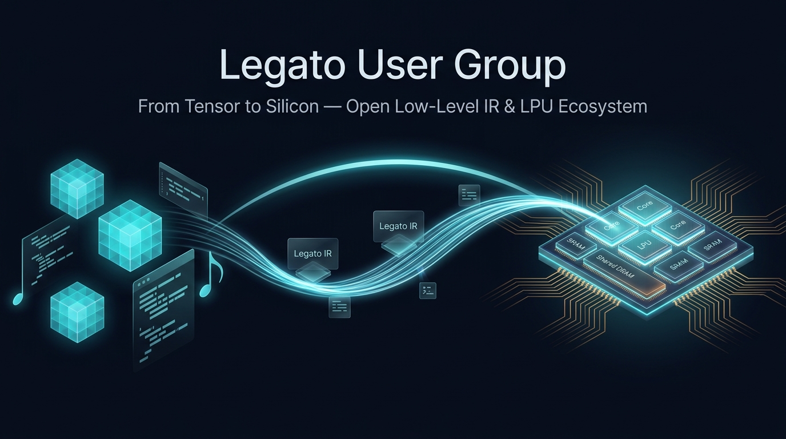

<div align="center">

<!-- .github 레포지토리의 profile/ 폴더에 배너 이미지를 업로드한 뒤 경로를 지정하세요 -->


# 🎵 Legato User Group
### **From Tensor to Silicon — Open Low-Level IR & LPU Ecosystem**

[](https://hyper-accel.github.io/posts/what-is-legato/)
[-F7585C?style=for-the-badge)](https://modulabs.co.kr/labs/811)
[-004EA2?style=for-the-badge)](https://www.iitp.kr)
[](https://opensource.org/licenses/Apache-2.0)

</div>

---

## 👋 Welcome to Legato User Group!

**Legato User Group**은 하이퍼엑셀(HyperAccel)의 LPU(LLM Processing Unit) 및 차세대 AI 가속기를 위한 프로그래밍 언어·저수준 공개 IR인 [**Legato**](https://hyper-accel.github.io/posts/what-is-legato/)와 **AI 시스템 소프트웨어(컴파일러·런타임·커널)**를 함께 탐구하고 기여하는 오픈소스 개발자·연구자 커뮤니티입니다.

> 🎵 **Why "Legato"?**  
> 음악에서 음과 음을 끊지 않고 매끄럽게 이어 연주하라는 지시어 **Legato(이음줄)**처럼, 상위 AI 모델·프레임워크(`PyTorch`, `vLLM`, `SGLang`)와 하위 AI반도체 실리콘(`LPU`, `NPU`) 사이를 단절 없이 매끄럽고 투명하게 연결한다는 의미를 담고 있습니다.

---

## ⚡ What is Legato? (핵심 설계 철학)

[**Legato**](https://hyper-accel.github.io/posts/what-is-legato/)는 복잡한 물리적 하드웨어 디테일을 추상화하면서도 개발자에게 **명시적 제어권과 투명성**을 제공하는 **Python 내장 DSL 및 MLIR 기반 컴파일러 스택**입니다.

- 🐍 **Python-Embedded DSL (`@legato.compile` & `torch.compile`)**
  - 익숙한 Python 문법과 텐서 추상화 위에서 동작하며, `@torch.compile(backend="legato")`를 통한 **완전 자동 경로(Mixed Execution / Fallback)**와 `@legato.compile`을 통한 **커스텀 커널 수동 튜닝 경로**를 모두 지원합니다.
- 🧩 **단순화된 가상 하드웨어 & 메모리 모델**
  - 모든 코어가 공유하는 `Shared DRAM` / `Virtual DRAM`과 코어별 전용 공간인 `Core Memory`(`SRAM` + `Private DRAM`)로 메모리를 추상화하고, `with device.get_top():` 및 `with device.get_core(i):`로 실행 컨텍스트를 직관적으로 분리합니다.
- 🔄 **명시적 데이터 이동 (`request_load` → `receive`)**
  - 어떤 텐서 데이터가 언제, 어느 메모리 계층(`shared_dram` → `sram` / `mpu_buffer`)으로 이동하는지 코드에 명시적으로 드러나 성능 병목을 정밀하게 제어할 수 있습니다.
- 🔍 **블랙박스 없는 투명한 컴파일 파이프라인 & 세대 호환성 (`ComputeModel`)**
  - `Python DSL` → `MLIR (Legato IR)` → `Core IR` → `Backend IR` → `ASM` → `ELF Binary`에 이르는 모든 중간 표현을 직접 추출·디버깅할 수 있으며, `ComputeModel` 교체를 통해 차세대 하드웨어 및 다양한 가속기 타깃으로 손쉽게 확장됩니다.

```python
@legato.compile(backend=get_bertha)
def simple_matmul(a, b, out):
    device = legato.get_context().get_device()

    # 1. Top 모듈: Shared DRAM -> Core 0의 SRAM / MPU Buffer로 데이터 로드 요청
    with device.get_top():
        legato.tensor.request_load(a, device.get_core(0), "sram")
        legato.tensor.request_load(b, device.get_core(0), "mpu_buffer")

    # 2. Core 0: 데이터 수신 후 MatMul 연산 및 결과 복사
    with device.get_core(0):
        loaded_a = legato.tensor.receive(a, 0, "sram")
        loaded_b = legato.tensor.receive_type(weight_type, 0, None, "mpu_buffer")
        result = loaded_a @ loaded_b
        legato.tensor.memcpy(out, result)
```

---

## 🧭 주요 활동 및 레포지토리 로드맵 (Projects & Roadmap)

| 구분 | 레포지토리 / 프로그램 | 설명 | 상태 |
| :---: | :--- | :--- | :---: |
| 📘 **학습 & 교재** | [**`tensor2silicon-lab`**](https://github.com/legato-user-group/tensor2silicon-lab) | **[T2S Lab]** AI 모델에서 가속기 커널까지 — 실행 스택, Roofline, Tiling, Triton, xPU, Legato를 다루는 오픈소스 온라인 교재 | 🟢 **진행 중** |
| 📄 **명세 & 문서** | `legato-docs` *(예정)* | Legato 저수준 IR 명세서, 프로그래밍 모델 가이드, API 레퍼런스 및 튜토리얼 (국/영문) | 🔜 공개 예정 |
| 💻 **샘플 & 툴킷** | `legato-samples` *(예정)* | 외부 개발자 온보딩을 위한 Legato 커널 작성 예제 및 PyTorch/vLLM 연동 샘플 | 🔜 공개 예정 |
| 🏆 **벤치마크** | `legato-leaderboard` *(예정)* | 오픈소스 기여자 중심의 AI 가속기 커널 성능 벤치마크 및 리더보드 | 🔜 공개 예정 |

---

## 🤝 함께하는 기관 (Consortium & Ecosystem Partners)

본 커뮤니티는 **과학기술정보통신부** 및 **정보통신기획평가원(IITP)**의 **「AI반도체를 활용한 K-클라우드 기술개발사업」**(*과제명: 지속적 AI반도체 성능 최적화를 위한 AI 생태계 적응형 시스템SW 기술 개발, `RS-2026-25521385`*)의 일환으로 산·학·연 컨소시엄과 함께 운영됩니다.

- **㈜하이퍼엑셀 (HyperAccel)** — Legato 저수준 공개 IR 설계, 컴파일러 백엔드·런타임 및 LPU(Bertha) 아키텍처 개발
- **서울대학교 (SNU)** — NPU 특화 커널 설계 공간 정의, 그래프 변환 및 연산·통신 중첩 스케줄링 최적화
- **한국과학기술원 (KAIST)** — NPU-GPU 이기종 LLM 서빙 시스템 시뮬레이터 및 클러스터 스케줄링 자동 탐색
- **모두의연구소 (MODULABS)** — 오픈소스 커뮤니티(Legato User Group) 운영, 공개 교재 집필(T2S Lab) 및 기술 컨퍼런스/워크숍 개최

---

## 🚀 참여 방법 (Get Involved)

- **Tech Blog 읽기**: [[Legato - Part 01] HyperAccel LPU를 위한 프로그래밍 언어](https://hyper-accel.github.io/posts/what-is-legato/)
- **스터디 & 공동 집필**: [모두의연구소 Tensor2Silicon LAB](https://modulabs.co.kr/labs/811)에서 주차별 리서치 노트와 실습 코드를 확인하고 Issue/PR로 피드백을 남겨주세요.
- **문의 (Contact)**: 모두의연구소 커뮤니티팀 이영빈 ([@yblee110](https://github.com/yblee110) / `yb.lee@modulabs.co.kr`)
